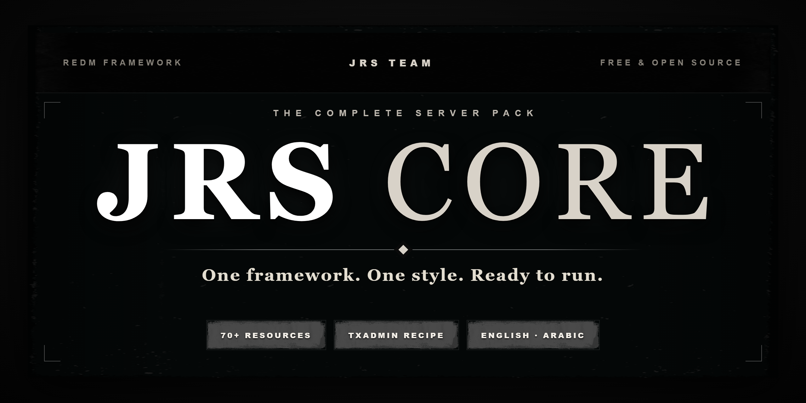

<div align="center" dir="rtl">



# JRS Core

**فريمورك رول بلاي متكامل وعالي الأداء لـ RedM.**
مبني بالكامل من الصفر بهندسة موحدة وكود نظيف وخالٍ تماماً من التبعات الخارجية.

[](LICENSE)
[](https://redm.net)
[](https://www.lua.org)
[](https://docs.jrs-core.com)
[](https://discord.gg/jrscore)

[التوثيق](https://docs.jrs-core.com) · [الديسكورد](https://discord.gg/jrscore) · [الإبلاغ عن خطأ](../../issues/new/choose) · [English](README.md)

</div>

---

<div dir="rtl">

## نظرة عامة

**JRS Core** هو نظام رول بلاي متكامل ومخصص لسيرفرات RedM تم تطويره لتقديم أقصى درجات الاستقرار وأقل استهلاك للموارد مع توفير تجربة تطوير سلسة ومباشرة. تعتمد جميع السكربتات على نموذج برمجي موحد ونظام استدعاءات وأحداث قياسي مع طبقة بيانات MySQL محسنة.

- **بنية برمجية موحدة:** خالية 100% من طبقات المحاكاة أو الفريموركات القديمة.
- **دعم كامل للغتين:** العربية والإنجليزية متوفرتان في كافة واجهات وأنظمة الكور.
- **أداء استثنائي:** تحسين كامل لحلقات المعالجة وتخفيف استهلاك NUI و CEF.
- **مجاني ومفتوح المصدر:** مرخص تحت رخصة GNU General Public License v3.0.

---

## السكربتات المضمنة في الحزمة

| المجلد | السكربت | الوصف |
|---|---|---|
| `[CORE]` | `jrs_core` | إدارة الشخصيات، الاقتصاد (كاش، ذهب، أموال مشبوهة)، الوظائف، الصلاحيات، الـ HUD، و RPC الخاص بـ JRS |
| `[CORE]` | `jrs_inventory` | حقيبة متكاملة تدعم السحب والإفلات، الخانات السريعة، الصناديق والمستودعات، الإسقاط الأرضي، والسرقة |
| `[CORE]` | `jrs_chat` | شات صوتي وكتابي محلي بقنوات مخصصة (`/me`, `/do`, `/s`, `/w`, `/ann`, `/ooc`) بتصميم غربي أصيل |
| `[CORE]` | `jrs_loadingscreen` | شاشة دخول احترافية تدعم الفيديو وسلايد الصور والتحكم الموحد بالصوت وعرض الطاقم والقوانين |
| `[CORE]` | `jrs_updater` | فاحص تلقائي للتحديثات والإصدارات |
| `[WORLD]` | `jrs_city` | نظام اكتشاف وعرض المدن والمناطق الجغرافية في RedM |

---

## المتطلبات الأساسية

- سيرفر RedM مع تفعيل **OneSync**.
- قاعدة بيانات MySQL أو MariaDB.
- مفتاح سيرفر رسمي من [Cfx.re Keymaster](https://keymaster.fivem.net).

---

## خطوات التثبيت

### الطريقة 1: عبر قالب txAdmin (الأسهل والأفضل)

1. افتح txAdmin واختر **Remote URL Template**.
2. الصق رابط القالب:
   ```text
   https://raw.githubusercontent.com/JRS-CORE/jrscore/main/recipe/jrscore.yaml
   ```
3. اتبع التعليمات لاستيراد قاعدة البيانات وإنشاء `server.cfg` تلقائياً.

### الطريقة 2: التثبيت اليدوي

1. ضع مجلد `resources` داخل المسار الرئيسي للسيرفر.
2. استورد ملف `sql/jrscore.sql` في قاعدة بيانات السيرفر.
3. رتب تشغيل السكربتات في ملف `server.cfg` كالتالي:
   ```cfg
   ensure oxmysql
   ensure jrs_core
   ensure jrs_inventory
   ensure jrs_chat
   ensure jrs_loadingscreen
   ```
4. تأكد من تفعيل `sv_enforceGameBuild 1491` في `server.cfg`.

---

## واجهة المطورين (API)

يمكنك استدعاء دوال الكور في أي سكربت بكل سهولة:

```lua
-- من طرف السيرفر (Server-side)
local JRS = exports['jrs_core']:getCoreApi()
local character = JRS.GetCharacter(source)

if character then
    JRS.AddMoney(source, 50.0)
    JRS.NotifyRightTip(source, 'تم استلام مكافأة: $50.00', 3000)
end

-- من طرف العميل (Client-side)
local JRS = exports['jrs_core']:getCoreApi()
JRS.NotifyRightTip('مرحباً بك في السيرفر', 4000)
```

---

## الدعم الفني والمجتمع

- **التوثيق والشروحات:** [docs.jrs-core.com](https://docs.jrs-core.com)
- **مجتمع الديسكورد:** [discord.gg/jrscore](https://discord.gg/jrscore)
- **الإبلاغ عن الأخطاء:** [فتح تذكرة على GitHub](../../issues/new/choose)

---

## التطوير

تم التطوير والصيانة بالكامل بواسطة **فريق JRS**.

---

## الرخصة

مشروع JRS Core برنامج حر ومفتوح المصدر تحت رخصة **GNU General Public License v3.0**.
راجع ملف [LICENSE](LICENSE) للمزيد من التفاصيل.

</div>
